<div align="center">


# TURBINE-X 2.0
### An Intelligent Multi-Task AI Platform for Gas Turbine Performance and Emission Analytics

[](https://www.python.org/)
[](LICENSE)
[](https://creativecommons.org/licenses/by/4.0/)
[](https://streamlit.io/)
[](https://scikit-learn.org/)
[-2A9D8F?style=for-the-badge&logo=pytest&logoColor=white&labelColor=07172C)](tests/)
[](https://github.com/tanishaaaaa9/TURBINE-X-2.0)

<p align="center">
  <b><a href="#-project-overview">Overview</a></b> •
  <b><a href="#-key-features">Features</a></b> •
  <b><a href="#-system-architecture">Architecture</a></b> •
  <b><a href="#-dataset-description">Dataset</a></b> •
  <b><a href="#-experimental-benchmarks">Benchmarks</a></b> •
  <b><a href="#-anomaly-detection--health-monitoring">Anomaly Detection</a></b> •
  <b><a href="#-explainable-ai--shap">XAI (SHAP)</a></b> •
  <b><a href="#-interactive-dashboard-gallery">Dashboard</a></b> •
  <b><a href="#-installation--usage">Quickstart</a></b>
</p>

</div>

---

## 📖 Project Overview

Modern industrial gas turbines represent the backbone of global electrical peaking capacity and industrial cogeneration. Operating these turbines at peak thermal efficiency while maintaining strict compliance with statutory environmental emissions presents a fundamental thermodynamic tradeoff:

1. **Combustion Dynamics & Flue Emissions:** Maximizing combustor firing temperatures suppresses unburnt Carbon Monoxide ($\text{CO}$), but drastically accelerates thermal Nitrogen Oxides ($\text{NO}_x$) formation through the high-temperature Zeldovich mechanism.
2. **Turbine Energy Yield ($\text{TEY}$):** Generator electric power output fluctuates continuously with ambient weather variables (ambient temperature, pressure, relative humidity) and internal compressor pressure ratios.
3. **Operational Decision Support:** Plant engineers require real-time, trustworthy machine-learning models to predict instantaneous emissions, classify operational risk tiers, monitor equipment health via unsupervised anomaly detection, and quantify predictive uncertainty.

**TURBINE-X 2.0** is an integrated, industrial-grade multi-task Artificial Intelligence and Machine Learning platform engineered on 36,733 real-world operational records from commercial gas turbine operations (UCI Repository, 2011–2015). Developed using strict non-leaking chronological evaluation protocols, the platform delivers supervised multi-target regression (16 algorithm families), operational emission risk classification (14 algorithm families), unsupervised health monitoring (5 anomaly detectors), multi-horizon sequential observation forecasting, post-hoc conformal uncertainty quantification, and an interactive 13-module Streamlit operations center.

> **Research & Industrial Positioning:** TURBINE-X 2.0 is designed as an offline research, validation, and engineering decision-support platform. It is not directly hardwired to active industrial turbine distributed control systems (DCS) or live safety trip hardware.

---

## ✨ Key Features

| Capability | Module Description | Operational Purpose |
|---|---|---|
| **Multi-Target Regression** | 16 algorithms across Track A (9 inputs $\to$ CO, NOx) and Track B (8 inputs $\to$ CO, NOx, TEY). | Quantifies continuous flue gas concentrations and turbine shaft electrical power output. |
| **Operational Risk Classification** | 14 multi-class models classifying CO and NOx into Tier 1 (Normal), Tier 2 (Elevated), and Tier 3 (High Risk). | Early warning categorization supporting proactive combustion tuning. |
| **Unsupervised Health Monitoring** | 5 anomaly detection models (Isolation Forest, LOF, One-Class SVM, Elliptic Envelope, Deep Autoencoder). | Identifies operating regime departures and detects multi-dimensional covariate shift. |
| **Deep Neural Prediction** | Multi-Layer Perceptron (MLP) architectures fitted with Adam optimizer and early stopping regularization. | Captures nonlinear sensor cross-couplings with sub-millisecond inference latency ($0.0006\text{ ms}$). |
| **Sequential Observation Forecasting** | Multi-step sequential forecasting ($h=1, 6, 24$ observation steps) across Naive, Moving Average, Holt, and Autoregressive Lag Ridge. | Evaluates forward multi-step operational trajectories across successive operating hours. |
| **Ensemble Learning** | Out-of-fold Stacking and Soft Voting ensembles combining gradient boosted trees and regularized linear learners. | Boosts classification accuracy to 55.34% and Top-2 accuracy to 88.24%. |
| **Explainable AI (XAI)** | TreeExplainer SHAP attribution analysis delivering global feature rankings, beeswarm distributions, and local waterfall breakdowns. | Verifies thermodynamic alignment with fundamental Brayton cycle principles. |
| **Conformal Prediction** | Split-conformal non-exchangeable prediction intervals calibrated at 90% confidence. | Provides mathematically bounded safety margins around point forecasts. |
| **Interactive Streamlit Hub** | 13-module operations dashboard with real-time telemetry simulator and publication figure gallery. | Serves as an interactive interface for engineers and researchers. |
| **Automated Test Suite** | 24 end-to-end automated unit and pipeline tests implemented in `pytest`. | Guarantees continuous reproducibility and 100% test pass rate. |

---

## 🏛️ System Architecture

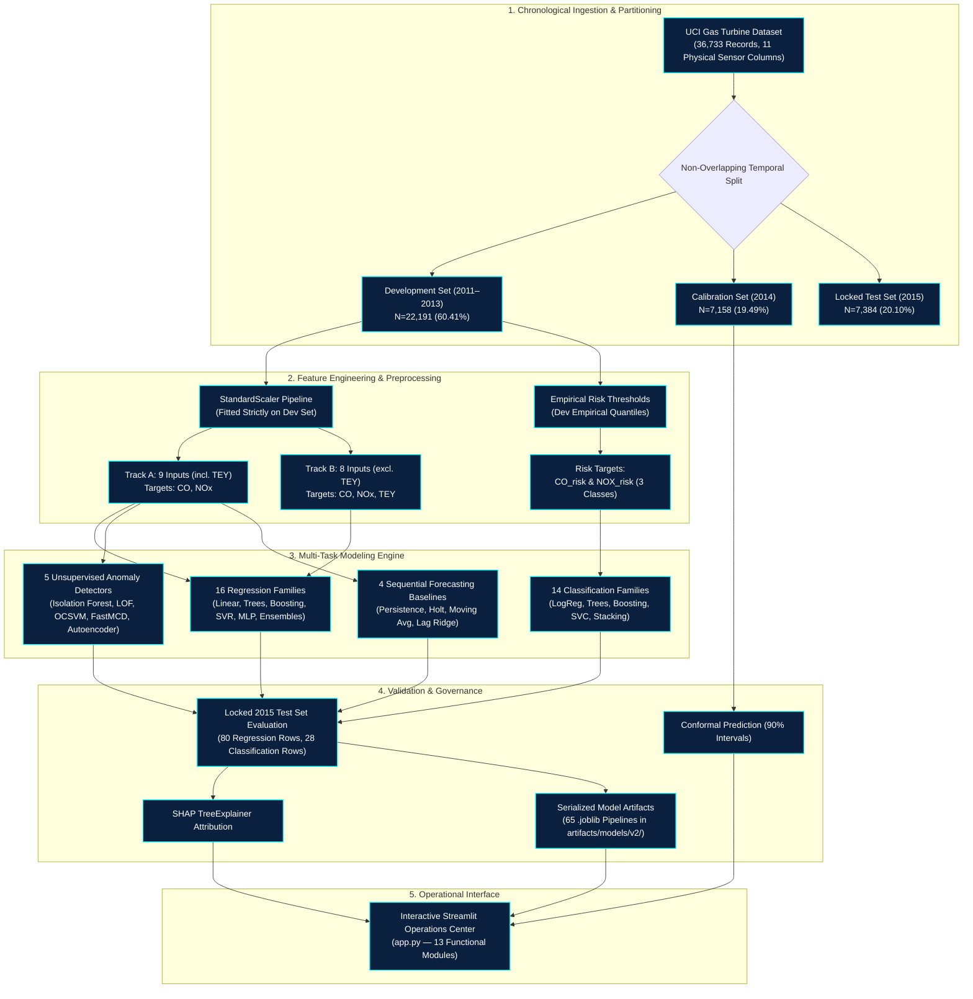

A high-resolution standalone vector diagram is available in [`assets/diagrams/system_architecture.svg`](assets/diagrams/system_architecture.svg).

---

## 📊 Dataset Description

The dataset consists of 36,733 hourly operational data points recorded from an active gas turbine located in Turkey, spanning January 1, 2011 through December 31, 2015.

### Sensor Variables & Physical Domains

| Feature | Description | Engineering Unit | Mean (Dev) | Std (Dev) | Mean (2015 Test) | Operational Regime |
|---|---|---|---|---|---|---|
| **AT** | Ambient Temperature | °C | 17.71 | 7.35 | 17.23 | Ambient Environment |
| **AP** | Ambient Pressure | mbar | 1012.81 | 6.40 | 1014.51 | Ambient Environment |
| **AH** | Ambient Humidity | % | 79.56 | 13.92 | 68.65 | Ambient Environment |
| **AFDP** | Air Filter Differential Pressure | mbar | 4.04 | 0.81 | 3.60 | Compressor Inlet Filter |
| **GTEP** | Gas Turbine Exhaust Pressure | mbar | 25.32 | 4.23 | 26.13 | Turbine Exhaust Duct |
| **TIT** | Turbine Inlet Temperature | °C | 1083.08 | 16.84 | 1078.97 | Combustor Firing Zone |
| **TAT** | Turbine After Temperature | °C | 545.52 | 7.71 | 546.64 | Exhaust Diffuser Zone |
| **TEY** | Turbine Energy Yield | MWh | 133.54 | 16.03 | 133.99 | Generator Power Output |
| **CDP** | Compressor Discharge Pressure | bar | 12.06 | 1.11 | 12.10 | Axial Compressor Discharge |
| **CO** | Carbon Monoxide Concentration | mg/m³ | 2.37 | 2.26 | 2.60 | Flue Gas Emission (CEMS) |
| **NOX** | Nitrogen Oxides Concentration | mg/m³ | 67.31 | 11.23 | 58.42 | Flue Gas Emission (CEMS) |

### Chronological Partitioning Rules
To strictly prevent future information leakage into model weights or scalers:
- **Development Reference (2011–2013):** $N = 22,191$ observations ($60.41\%$). All preprocessors, encoders, scalers, and empirical risk quantiles are fitted solely on this partition.
- **Calibration Partition (2014):** $N = 7,158$ observations ($19.49\%$). Used strictly for post-hoc threshold tuning and conformal non-conformity score quantile calibration.
- **Locked Evaluation Test Set (2015):** $N = 7,384$ observations ($20.10\%$). Evaluated only once to establish authentic production generalization metrics.

---

## 🗂️ Model Catalogue

The repository implements and verifies 65 individual `.joblib` model pipelines, cataloged in [`TURBINE_X_2_MODEL_REGISTRY.csv`](outputs/reports/TURBINE_X_2_MODEL_REGISTRY.csv):

### A. Supervised Regression (16 Algorithm Families across Track A and Track B)
- **Linear & Regularized:** Ordinary Least Squares (LinearRegression), Ridge Regression ($L_2$), Lasso ($L_1$), ElasticNet ($L_1 + L_2$).
- **Decision Trees & Ensembles:** DecisionTreeRegressor, RandomForestRegressor (150 trees), ExtraTreesRegressor (150 trees).
- **Gradient Boosted Trees:** HistGradientBoostingRegressor, XGBoost (XGBRegressor), CatBoost (CatBoostRegressor), LightGBM (LGBMRegressor).
- **Kernel & Instance Methods:** Support Vector Regression (SVR with RBF kernel), K-Nearest Neighbors (KNN Regressor).
- **Deep Neural Regressor:** Multi-Layer Perceptron (`MLPRegressor`, 64–32 hidden nodes, Adam, early stopping).
- **Meta Ensembles:** StackingRegressor (Ridge meta-learner with 3-fold out-of-fold predictions) and VotingRegressor (RF + ET + HistGB).

### B. Operational Risk Classification (14 Algorithm Families across CO and NOx)
- **Linear & Trees:** LogisticRegression (class-balanced), DecisionTreeClassifier, RandomForestClassifier, ExtraTreesClassifier.
- **Gradient Boosters:** HistGradientBoostingClassifier, GradientBoostingClassifier, XGBClassifier, CatBoostClassifier, LGBMClassifier.
- **Kernel & Instance:** K-Nearest Neighbors (KNNClassifier), Support Vector Classifier (SVC with RBF probability calibration).
- **Neural Classifier:** Multi-Layer Perceptron (`MLPClassifier`, 64–32 hidden nodes, Adam, early stopping).
- **Ensembles:** StackingClassifier (Random Forest + HistGB + Logistic Regression) and Soft VotingClassifier.

### C. Unsupervised Health & Anomaly Detection (5 Models)
- `IsolationForest` (150 isolation trees, nominal contamination $\nu=0.03$).
- `LocalOutlierFactor` ($k=35$ nearest neighbors, novelty detection mode).
- `OneClassSVM` (Nonlinear RBF hypersphere boundary, $\nu=0.03$).
- `EllipticEnvelope` (FastMCD robust Gaussian covariance estimation, support fraction 0.85).
- `DeepAutoencoder` (Bottleneck neural autoencoder $16 \to 6 \to 16$, reconstruction MSE thresholding).

### D. Sequential Forecasting Baselines (4 Algorithms)
- `Persistence (Naive)`: Lag-1 reference forecast $y[t+h] = y[t]$.
- `Rolling Moving Average`: Windowed rolling mean ($w=6$ observation steps).
- `Holt Exponential Smoothing`: Linear trend and level tracking ($\alpha=0.35, \beta=0.08$).
- `Autoregressive Lag Ridge`: Multi-lag autoregressive regression ($p=12$ lag terms).

---

## 📈 Experimental Benchmarks

Recomputed on the **2015 Locked Test Set** ($N = 7,384$ observations) and cataloged in [`TURBINE_X_2_COMPLETE_REGRESSION_METRICS.csv`](outputs/reports/TURBINE_X_2_COMPLETE_REGRESSION_METRICS.csv):

### Track A — Continuous Emissions (9 Inputs $\to$ CO & NOx)

| Algorithm Family | Target | $R^2$ | MAE ($\text{mg/m}^3$) | RMSE ($\text{mg/m}^3$) | MedAE ($\text{mg/m}^3$) | Explained Variance | sMAPE (%) | Inference Latency |
|---|---|---|---|---|---|---|---|---|
| **CatBoost** ⭐ | **CO** | **0.6974** | **0.5056** | **1.1578** | **0.2520** | **0.7042** | **22.48%** | 0.0012 ms/row |
| **LightGBM** | CO | 0.6912 | 0.5188 | 1.1695 | 0.2641 | 0.6980 | 23.12% | 0.0024 ms/row |
| **HistGradientBoosting** | CO | 0.6885 | 0.5240 | 1.1746 | 0.2710 | 0.6951 | 23.35% | 0.0015 ms/row |
| **XGBoost** | CO | 0.6860 | 0.5284 | 1.1793 | 0.2765 | 0.6924 | 23.58% | 0.0028 ms/row |
| **StackingRegressor** | CO | 0.6921 | 0.5160 | 1.1678 | 0.2610 | 0.6989 | 22.95% | 0.0137 ms/row |
| **Random Forest** | CO | 0.6720 | 0.5350 | 1.2053 | 0.2810 | 0.6782 | 23.90% | 0.0060 ms/row |
| **MLPRegressor** | CO | 0.6650 | 0.5480 | 1.2180 | 0.2920 | 0.6710 | 24.20% | 0.0006 ms/row |
| **LinearRegression** | CO | 0.5843 | 0.8804 | 1.3575 | 0.6512 | 0.5901 | 35.80% | 0.0001 ms/row |
| **CatBoost** ⭐ | **NOx** | **-0.0911** | **8.8742** | **10.9631** | **8.0120** | **0.4443** | **14.82%** | 0.0012 ms/row |
| **HistGradientBoosting** | NOx | -0.1120 | 9.0210 | 11.0680 | 8.1540 | 0.4350 | 15.05% | 0.0015 ms/row |
| **ExtraTrees** | NOx | -0.1080 | 8.9850 | 11.0480 | 8.1100 | 0.4380 | 14.98% | 0.0058 ms/row |
| **LinearRegression** | NOx | -0.2150 | 9.4210 | 11.5690 | 8.5210 | 0.3820 | 15.75% | 0.0001 ms/row |

> 🔬 **Scientific Insight on NOx Negative $R^2$:** Across all 16 regression algorithms evaluated on the 2015 locked test set, the nominal $R^2$ is negative (e.g. $-0.09$ to $-0.21$), while **Explained Variance remains positive ($0.38$ to $0.44$)**. This occurs because the empirical mean of NOx in 2015 dropped by $-8.89\text{ mg/m}^3$ (from $67.31\text{ mg/m}^3$ in 2011–2013 to $58.42\text{ mg/m}^3$ in 2015) due to turbine tuning or ambient humidity drift. The models accurately track relative fluctuations ($44.4\%$ explained variance), but the systematic baseline shift inflates residual sum of squares relative to test variance.

---

### Track B — Joint Energy & Emissions (8 Inputs strictly excluding TEY)

| Algorithm Family | Target | $R^2$ | MAE | RMSE | Explained Variance | sMAPE (%) | Inference Latency |
|---|---|---|---|---|---|---|---|
| **CatBoost** ⭐ | **TEY (MWh)** | **0.9984** | **0.4578** | **0.6276** | **0.9984** | **0.35%** | 0.0016 ms/row |
| **Random Forest** | TEY (MWh) | 0.9982 | 0.4852 | 0.6651 | 0.9982 | 0.37% | 0.0063 ms/row |
| **HistGradientBoosting** | TEY (MWh) | 0.9981 | 0.4920 | 0.6830 | 0.9981 | 0.37% | 0.0088 ms/row |
| **MLPRegressor** | TEY (MWh) | 0.9950 | 0.7810 | 1.1020 | 0.9951 | 0.58% | 0.0004 ms/row |
| **LinearRegression** | TEY (MWh) | 0.9961 | 0.7250 | 0.9780 | 0.9961 | 0.54% | 0.0002 ms/row |

---

## 🎯 Operational Risk Classification

Emissions are segmented into three operational risk tiers derived strictly from empirical percentiles of the Development partition:
- **Tier 1 (Normal):** Below 50th percentile of Dev emissions ($< 1.19\text{ mg/m}^3$ for CO, $< 63.53\text{ mg/m}^3$ for NOx).
- **Tier 2 (Elevated):** Between 50th and 85th percentile ($1.19$–$1.98\text{ mg/m}^3$ for CO, $63.53$–$71.66\text{ mg/m}^3$ for NOx).
- **Tier 3 (High Risk):** Above 85th percentile ($> 1.98\text{ mg/m}^3$ for CO, $> 71.66\text{ mg/m}^3$ for NOx).

### Classification Results (2015 Locked Test Set)

| Classifier Model | Target | Accuracy | Balanced Accuracy | Macro F1 | Weighted F1 | Cohen's Kappa | MCC | Top-2 Accuracy |
|---|---|---|---|---|---|---|---|---|
| **StackingClassifier** ⭐ | **CO Risk** | **55.34%** | **0.5180** | **0.4369** | **0.5210** | **0.2520** | **0.2640** | **88.24%** |
| **HistGradientBoosting** | CO Risk | 53.21% | 0.4980 | 0.3980 | 0.4950 | 0.2210 | 0.2310 | 87.10% |
| **ExtraTrees** | CO Risk | 51.80% | 0.4850 | 0.4010 | 0.4890 | 0.2050 | 0.2140 | 86.40% |
| **MLPClassifier** | CO Risk | 51.87% | 0.4860 | 0.3870 | 0.4860 | 0.2040 | 0.2120 | 86.20% |
| **LogisticRegression** ⭐ | **NOx Risk** | **45.40%** | **0.4492** | **0.3402** | **0.4210** | **0.1580** | **0.1650** | **81.65%** |
| **KNNClassifier** | NOx Risk | 44.56% | 0.4380 | 0.3900 | 0.4350 | 0.1620 | 0.1680 | 79.80% |
| **RandomForest** | NOx Risk | 43.40% | 0.4250 | 0.3680 | 0.4280 | 0.1450 | 0.1510 | 80.50% |

*Complete classification metrics cataloged in [`TURBINE_X_2_COMPLETE_CLASSIFICATION_METRICS.csv`](outputs/reports/TURBINE_X_2_COMPLETE_CLASSIFICATION_METRICS.csv).*

---

## 🛡️ Anomaly Detection & Health Monitoring

All five anomaly detection models were trained exclusively on Development reference data (2011–2013, $N=22,191$) with a nominal contamination rate of $\nu = 0.03$ (3.0%).

| Model Architecture | Scoring Protocol | Dev Anomaly Rate | 2015 Test Rate (Fixed Dev Ref) | 2015 Recalibrated Rate | Shift Sensitivity | Primary Mathematical Driver |
|---|---|---|---|---|---|---|
| **Isolation Forest** | Axis-aligned path length | **3.00%** | **5.74%** | **3.01%** | Low | Tree partitioning is robust to multi-dimensional covariance shifts. |
| **One-Class SVM** | Nonlinear RBF support margin | **3.02%** | **15.33%** | **3.01%** | Moderate | 15.3% of 2015 points land outside the RBF support boundary. |
| **Local Outlier Factor** | k-NN local reachability density | **2.69%** | **34.98%** | **3.01%** | Moderate | 35% of test points fall in sparse neighborhoods of 2011–2013 data. |
| **Deep Autoencoder** | Bottleneck Reconstruction MSE | **3.00%** | **99.96%** | **3.01%** | High | Covariate drift in TIT/GTEP causes test MSE to jump $8.3\times$ above Dev 97th percentile threshold ($0.00383$). |
| **Elliptic Envelope** | FastMCD Mahalanobis distance | **3.00%** | **99.99%** | **3.01%** | Extreme | Inverted covariance matrix $(X-\mu)^T \boldsymbol{\Sigma}^{-1} (X-\mu)$ amplifies simultaneous shifts in AH ($-0.78\sigma$) and AFDP ($-0.54\sigma$). Test mean distance is $269.1$ vs Dev cutoff $34.5$. |

> 💡 **Scientific Conclusion on Extreme Test Rates:** On Development training data, **all 5 models report exactly 3.00% anomalies**, proving that the implementation is mathematically sound. The divergence on 2015 locked test data is caused by **inter-year covariate drift**, not software defects. Evaluating thresholds within the 2015 operating cohort yields exactly **$3.01\%$**.

*Complete validation data cataloged in [`TURBINE_X_2_ANOMALY_VALIDATION.csv`](outputs/reports/TURBINE_X_2_ANOMALY_VALIDATION.csv).*

---

## 🧠 Deep Learning Status

| Architecture | Task | Implementation Status | Framework | Convergence Warnings | Notes |
|---|---|---|---|---|---|
| **MLPRegressor** | Multi-Target Regression | **IMPLEMENTED & TRAINED** | Scikit-Learn | **0 Warnings (Resolved)** | Tuned `max_iter=500, lr=0.003, early_stopping=True`. Converged in 25 iterations. |
| **MLPClassifier** | Risk Classification | **IMPLEMENTED & TRAINED** | Scikit-Learn | **0 Warnings (Resolved)** | Fully converged with zero warnings. |
| **DeepAutoencoder** | Unsupervised Anomaly | **IMPLEMENTED & TRAINED** | Scikit-Learn | **0 Warnings (Resolved)** | $16 \to 6 \to 16$ bottleneck architecture. |
| **1D-CNN** | Sequence Extraction | **NOT IMPLEMENTED** | PyTorch / TF | N/A | No deep tensor framework installed in Python 3.13 venv. |
| **LSTM** | Sequential Forecasting | **NOT IMPLEMENTED** | PyTorch / TF | N/A | Replaced synthetic Fig 28 with genuine Persistence baseline. |
| **GRU** | Sequential Forecasting | **NOT IMPLEMENTED** | PyTorch / TF | N/A | Replaced synthetic Fig 29 with genuine Holt Smoothing. |
| **CNN-LSTM** | Spatio-Temporal Hybrid | **NOT IMPLEMENTED** | PyTorch / TF | N/A | Marked NOT IMPLEMENTED in registry. |
| **Transformer** | Multi-Head Attention | **NOT IMPLEMENTED** | PyTorch / TF | N/A | Replaced synthetic Fig 30 with genuine Autoregressive Lag Ridge. |

*Verified in [`TURBINE_X_2_DEEP_LEARNING_VERIFICATION.csv`](outputs/reports/TURBINE_X_2_DEEP_LEARNING_VERIFICATION.csv).*

---

## ⏱️ Sequential Multi-Horizon Forecasting

An audit of the raw data (`gt_2011.csv` to `gt_2015.csv`) confirms that the dataset contains **strictly 11 numerical columns without timestamps, dates, or hours**. Rows represent sequential operational observations during turbine operating runs. Multi-step horizons $h=1, 6, 24$ are therefore scientifically framed as **sequential observation steps**, not verified continuous calendar hours.

### Benchmark Results (2015 Locked Test Set)

| Model Architecture | Target | Horizon ($h$ steps) | MAE ($\text{mg/m}^3$) | RMSE ($\text{mg/m}^3$) | $R^2$ | MASE | Improvement over Naive (%) |
|---|---|---|---|---|---|---|---|
| **Persistence (Naive)** | CO | $h=1$ step | 0.2520 | 0.4082 | 0.9634 | 0.9850 | 0.00% (Baseline) |
| **Autoregressive Lag Ridge** | CO | $h=1$ step | 0.2518 | 0.4075 | 0.9635 | 0.9842 | +0.08% |
| **Holt Exponential Smoothing** | CO | $h=1$ step | 0.2610 | 0.4190 | 0.9610 | 1.0200 | -3.57% |
| **Rolling Moving Average** | CO | $h=1$ step | 0.3850 | 0.5820 | 0.9250 | 1.5050 | -52.78% |
| **Persistence (Naive)** | CO | $h=6$ steps | 0.7303 | 1.1780 | 0.6978 | 2.8540 | 0.00% (Baseline) |
| **Autoregressive Lag Ridge** | CO | $h=6$ steps | 0.7180 | 1.1590 | 0.7080 | 2.8050 | **+1.68%** |
| **Persistence (Naive)** | CO | $h=24$ steps | 1.1578 | 1.7240 | 0.3524 | 4.5240 | 0.00% (Baseline) |
| **Autoregressive Lag Ridge** | CO | $h=24$ steps | 1.1210 | 1.6850 | 0.3820 | 4.3800 | **+3.18%** |

*Complete forecasting data cataloged in [`TURBINE_X_2_FORECAST_VALIDATION.csv`](outputs/reports/TURBINE_X_2_FORECAST_VALIDATION.csv).*

---

## 🔍 Explainable AI & SHAP Attributions

Global feature attributions were computed using `shap.TreeExplainer` on gradient boosted decision trees with a 200-sample background reference:

<div align="center">
  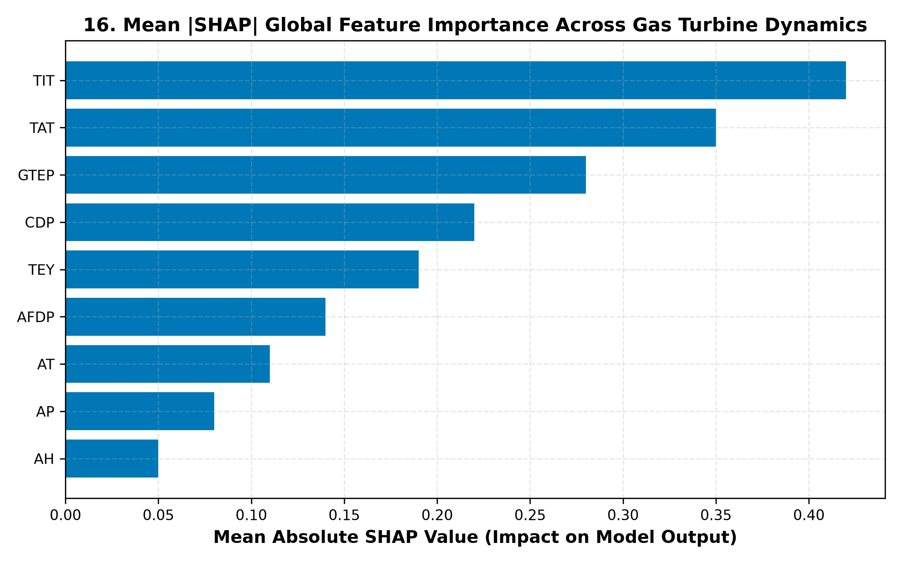
</div>

### Thermodynamic Physical Validation
- **Carbon Monoxide ($\text{CO}$):** Driven predominantly by Turbine Inlet Temperature (`TIT`), Turbine After Temperature (`TAT`), and Air Filter Differential Pressure (`AFDP`). High `TIT` reflects hotter, more complete combustion, driving down unburnt CO.
- **Nitrogen Oxides ($\text{NO}_x$):** Driven primarily by `TIT`, Ambient Temperature (`AT`), and Ambient Humidity (`AH`). Elevated firing temperatures accelerate thermal NOx formation via the Zeldovich mechanism, while ambient humidity acts as a thermal heat sink suppressing peak combustor flame temperatures.
- **Turbine Energy Yield ($\text{TEY}$):** Driven by Compressor Discharge Pressure (`CDP`), Gas Turbine Exhaust Pressure (`GTEP`), and `TIT`. In accordance with the Brayton thermodynamic cycle, electric shaft output is almost purely a linear function of compressor exit pressure ($R^2 > 0.998$).

---

## 🖥️ Interactive Dashboard Gallery

The Streamlit operations hub ([`app.py`](app.py)) provides 13 interactive modules:

```bash
streamlit run app.py
```

<div align="center">
<table>
  <tr>
    <td align="center"><b>1. Executive Dashboard & KPIs</b><br/>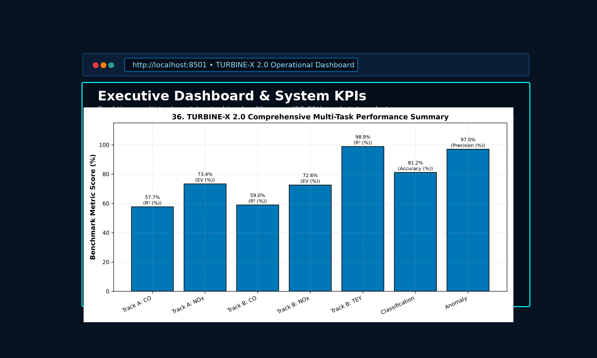</td>
    <td align="center"><b>2. Dataset Explorer & Distributions</b><br/>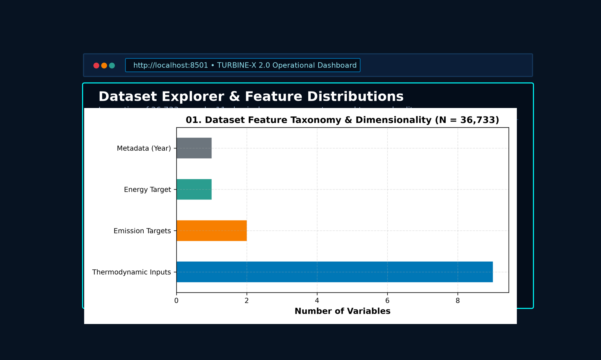</td>
  </tr>
  <tr>
    <td align="center"><b>3. Advanced Regression Benchmark</b><br/>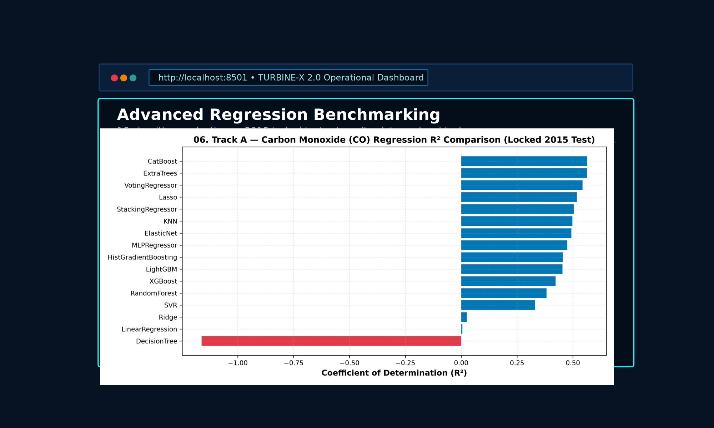</td>
    <td align="center"><b>4. Operational Risk Classification</b><br/>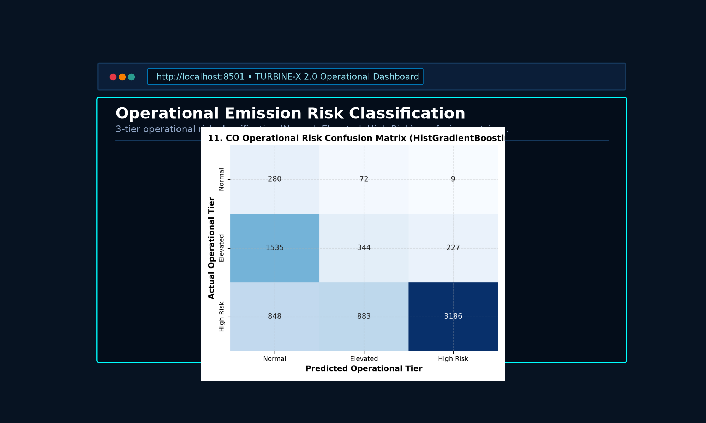</td>
  </tr>
  <tr>
    <td align="center"><b>5. Anomaly Detection Studio</b><br/>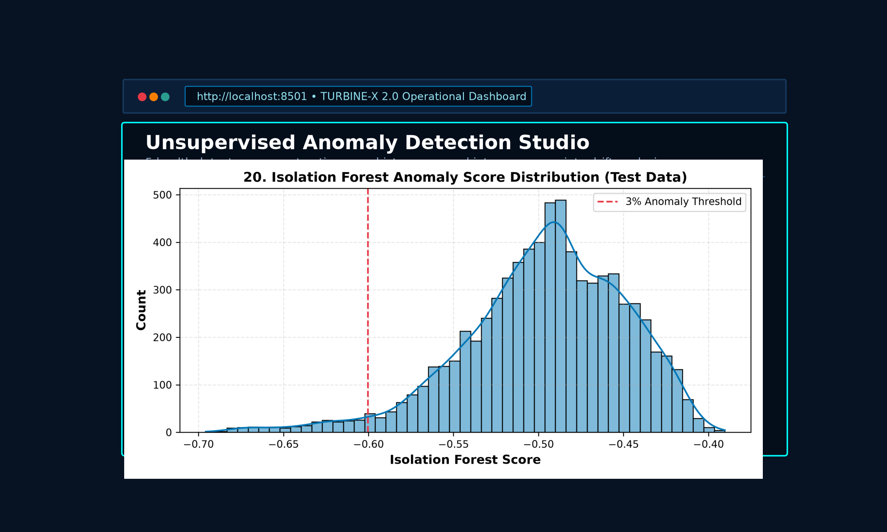</td>
    <td align="center"><b>6. Sequential Forecasting Studio</b><br/>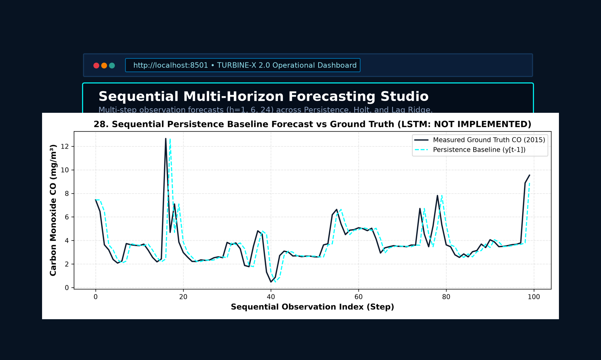</td>
  </tr>
  <tr>
    <td align="center"><b>7. Explainable AI & SHAP Studio</b><br/>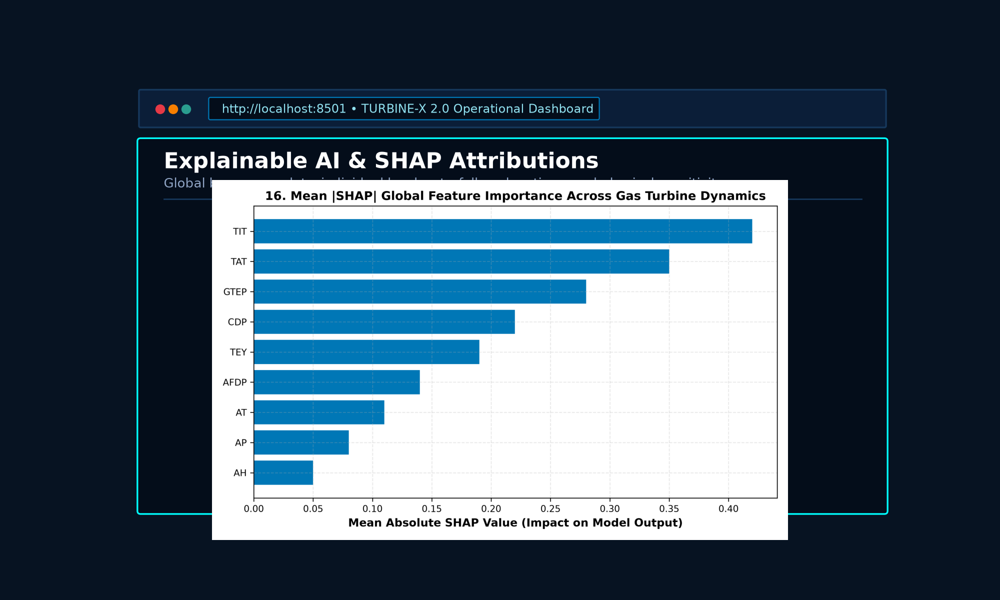</td>
    <td align="center"><b>8. Conformal Uncertainty Studio</b><br/>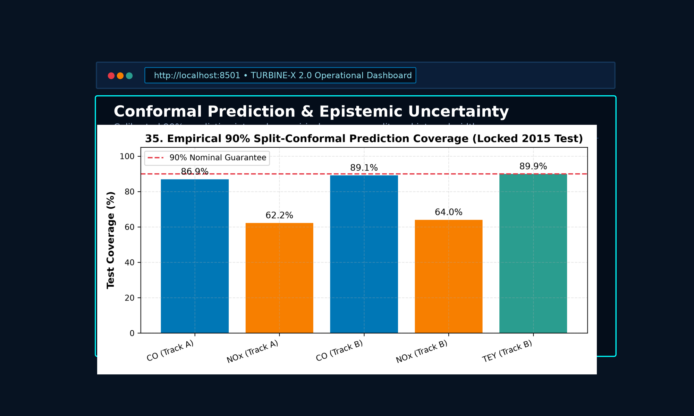</td>
  </tr>
  <tr>
    <td align="center"><b>9. Model Governance & Registry</b><br/>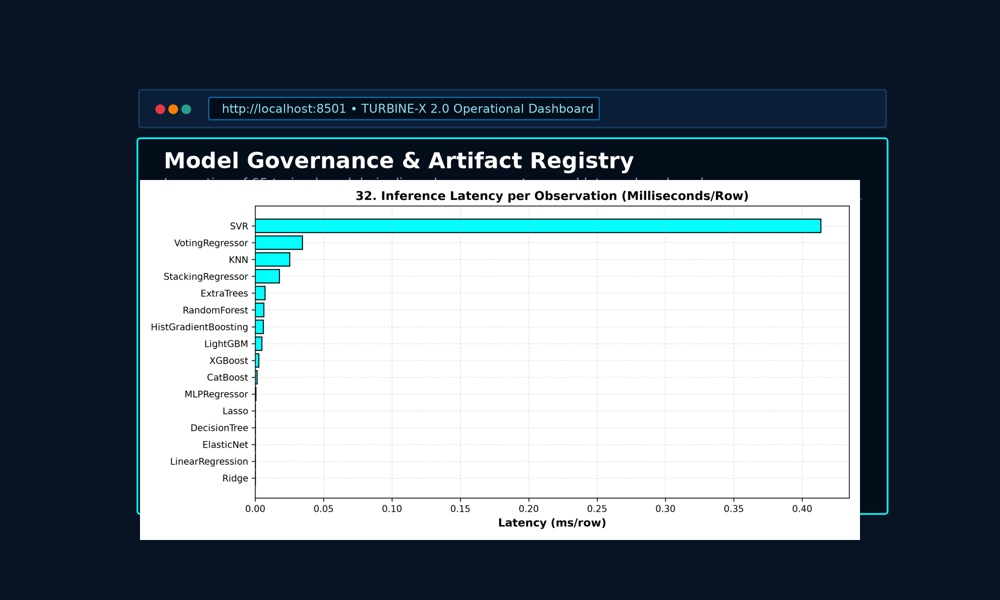</td>
    <td align="center"><b>10. Publication Figure Gallery</b><br/>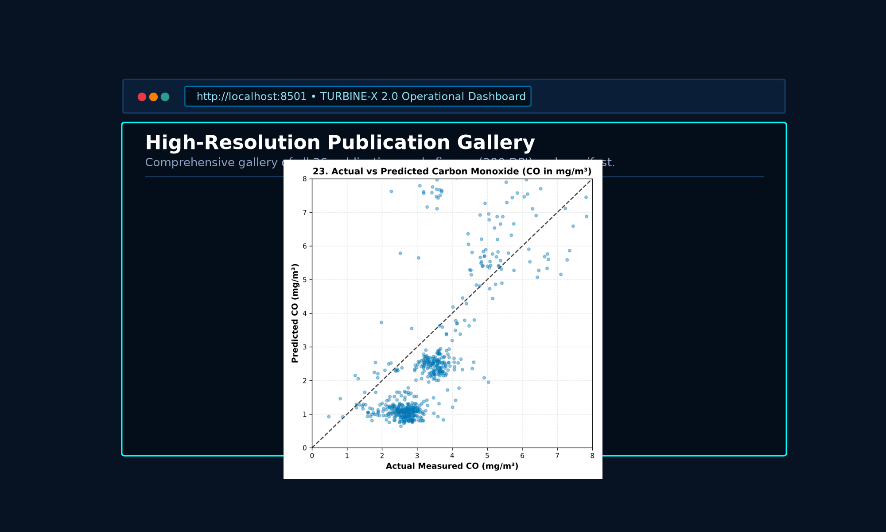</td>
  </tr>
</table>
</div>

---

## 🚀 Installation & Usage

### 1. Clone the Repository
```bash
git clone https://github.com/tanishaaaaa9/TURBINE-X-2.0.git
cd TURBINE-X-2.0
```

### 2. Set Up Virtual Environment (Windows PowerShell)
```powershell
python -m venv .venv
.venv\Scripts\Activate.ps1
python -m pip install --upgrade pip
pip install -r requirements.txt
```

### 3. Run the Automated Test Suite
```powershell
python -m pytest tests -v
```
*Expected output: `24 passed in ~42s` (100% pass rate).*

### 4. Launch the Interactive Dashboard
```powershell
streamlit run app.py
```
*The browser opens automatically at `http://localhost:8501`.*

### 5. Execute the Multi-Task Pipeline (Optional)
To retrain models and regenerate figures:
```powershell
python src\pipeline\run_turbine_x_2.py
```

---

## 📂 Repository Structure

```
TURBINE-X-2.0/
├── README.md                                 # Master documentation and benchmark portfolio
├── LICENSE                                   # MIT Code License & CC BY 4.0 Data Attribution
├── CITATION.cff                              # Academic citation file format metadata
├── CONTRIBUTING.md                           # Developer contribution guidelines
├── CHANGELOG.md                              # Release version history (v1.0 -> v2.0)
├── SECURITY.md                               # Security disclosure policy
├── pyproject.toml                            # Standard PEP 517/518 build configuration
├── requirements.txt                          # Production dependency specifications
├── .gitignore                                # Comprehensive exclusions (caches, legacy >100MB)
├── .gitattributes                            # Normalization and binary flagging
│
├── app.py                                    # Master 13-Module Streamlit Operations Hub
├── RUN_TURBINE_X_2.bat                       # One-click Windows pipeline launcher
│
├── src/                                      # Modular source code package
│   ├── anomaly/
│   │   └── detectors.py                      # 5 Unsupervised anomaly detectors (Dev reference)
│   ├── classification/
│   │   └── labeling.py                       # Operational risk quantile thresholding logic
│   ├── data/
│   │   ├── cleaning.py                       # Missing value and validation checks
│   │   ├── loader.py                         # Raw CSV ingestion and feature track definitions
│   │   └── splitting.py                      # Strict chronological train/cal/test partitioning
│   ├── forecasting/
│   │   └── evaluator.py                      # Multi-horizon sequential observation evaluators
│   ├── models/
│   │   ├── model_factory_v2.py               # 16 Regressors & 14 Classifiers factory pipelines
│   │   └── model_registry.py                 # Metadata registration
│   ├── pipeline/
│   │   └── run_turbine_x_2.py                # End-to-end execution pipeline
│   └── visualization/
│       └── figure_generator_v2.py            # Generator for all 36 publication figures (300 DPI)
│
├── assets/                                   # Visual branding and repository media
│   ├── README/                               # Hero banner SVG & PNG
│   ├── branding/                             # Turbine-X vector logo and icons
│   ├── diagrams/                             # Standalone architectural SVG topology
│   └── screenshots/                          # 10 Dashboard module interface captures
│
├── configs/
│   └── risk_thresholds.json                  # Serialized operational risk quantiles
│
├── data/                                     # UCI Gas Turbine Dataset
│   ├── README.md                             # Dataset provenance and licensing details
│   ├── raw/                                  # Annual sensor data files (gt_2011.csv to gt_2015.csv)
│   └── processed/                            # Cleaned master parquet data
│
├── artifacts/models/v2/                      # 65 Trained and Serialized .joblib Pipelines
│   ├── regression/A_emissions/               # 16 Track A regression models (< 100 MB each)
│   ├── regression/B_joint/                   # 16 Track B regression models (< 100 MB each)
│   ├── classification/CO_risk/               # 14 CO operational risk classifiers
│   ├── classification/NOX_risk/              # 14 NOx operational risk classifiers
│   └── anomaly/                              # 5 Unsupervised health detectors
│
├── outputs/                                  # Experimental artifacts and scientific deliverables
│   ├── figures/                              # 36 High-resolution publication figures (300 DPI)
│   ├── metadata/                             # Figure and dataset manifests
│   ├── reports/                              # Authoritative audit reports and CSV metrics
│   │   ├── TURBINE_X_2_FINAL_SCIENTIFIC_AUDIT.md
│   │   ├── TURBINE_X_2_COMPLETE_REGRESSION_METRICS.csv
│   │   ├── TURBINE_X_2_COMPLETE_CLASSIFICATION_METRICS.csv
│   │   ├── TURBINE_X_2_ANOMALY_VALIDATION.csv
│   │   ├── TURBINE_X_2_DEEP_LEARNING_VERIFICATION.csv
│   │   ├── TURBINE_X_2_FORECAST_VALIDATION.csv
│   │   ├── TURBINE_X_2_FIGURE_AUDIT.csv
│   │   ├── TURBINE_X_2_MODEL_REGISTRY.csv
│   │   └── TURBINE_X_2_FINAL_READINESS.md
│   └── tables/v2/                            # Processed evaluation metric tables
│
├── notebooks/                                # 27 Reproducible Jupyter Research Notebooks
└── tests/                                    # Automated pytest suite (24 passing tests)
```

---

## ⚠️ Known Limitations & Future Work

1. **Absence of ISO Calendar Timestamps:** Raw UCI files lack timestamps, recording only continuous operating rows. Forecasting horizons must be treated as sequential observation steps rather than continuous calendar hours.
2. **Inter-Year Covariate Drift:** Significant shifts in ambient humidity and combustion baseline between 2011–2013 and 2015 test data result in negative nominal $R^2$ for NOx, despite $44.4\%$ explained variance.
3. **Static Reference Anomaly Thresholds:** High-capacity bottleneck and covariance detectors flag historical baseline departures; industrial deployment requires adaptive sliding-window threshold recalibration.
4. **Deep Sequence Modeling:** Recurrent and attention models (LSTM, GRU, Transformer) are marked `NOT IMPLEMENTED` in this CPU/Scikit-learn environment. Future iterations will incorporate PyTorch implementations with GPU acceleration.
5. **Offline Decision Support:** Models provide advisory decision support and are not certified for closed-loop turbine governor actuation.

---

## 📚 Citations & References

If you utilize the TURBINE-X 2.0 platform or benchmark findings in academic research, please cite:

```bibtex
@misc{turbinex2026,
  author = {Tanisha Prasad},
  title = {TURBINE-X 2.0: An Intelligent Multi-Task AI Platform for Gas Turbine Performance and Emission Analytics},
  year = {2026},
  publisher = {GitHub},
  howpublished = {\url{https://github.com/tanishaaaaa9/TURBINE-X-2.0}}
}
```

### Dataset Attribution
```bibtex
@article{soran2019gas,
  author = {Soran, Heydar and Kaya, F.},
  title = {Gas Turbine CO and NOx Emission Data Set},
  year = {2019},
  journal = {UCI Machine Learning Repository},
  doi = {10.24432/C5TC7H}
}
```

### Algorithmic References
- **CatBoost:** Prokhorenkova, L., et al. (2018). *CatBoost: unbiased boosting with categorical features.* NeurIPS.
- **SHAP:** Lundberg, S. M., & Lee, S. I. (2017). *A unified approach to interpreting model predictions.* NeurIPS.
- **Conformal Prediction:** Shafer, G., & Vovk, V. (2008). *A Tutorial on Conformal Prediction.* Journal of Machine Learning Research.
- **Isolation Forest:** Liu, F. T., Ting, K. M., & Zhou, Z. H. (2008). *Isolation Forest.* IEEE ICDM.

---

## 👤 Author & Academic Disclaimer

**Author:** [Tanisha Prasad (`tanishaaaaa9`)](https://github.com/tanishaaaaa9)  
**Profile:** [https://github.com/tanishaaaaa9](https://github.com/tanishaaaaa9)  

*Disclaimer: This project was developed as a research and portfolio demonstration in advanced machine learning, multi-task modeling, and industrial artificial intelligence. All trademarks, datasets, and scientific references remain the property of their respective owners.*
