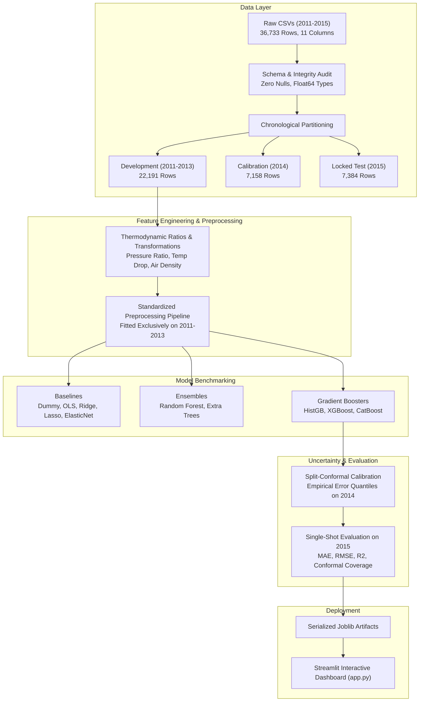

# TURBINE-X: Project Overview & Executive Technical Summary

## 1. Project Identification
- **Project Name:** TURBINE-X — Comprehensive Gas Turbine Emission Prediction and Machine Learning Benchmarking System
- **Dataset:** UCI Gas Turbine CO and NOx Emission Data Set (2011–2015, 36,733 records, 11 features)
- **DOI:** [10.24432/C5WC95](https://doi.org/10.24432/C5WC95)
- **Primary Authors / Curators:** Heydar Kaya and Pınar Tüfekci
- **Benchmarking Engine:** Python 3.13, Scikit-Learn 1.9, XGBoost, CatBoost, Optuna, Streamlit
- **Validation Protocol:** Chronological Temporal Split (2011–2013: Dev, 2014: Cal, 2015: Locked Test)

---

## 2. Executive Summary & Problem Formulation
Industrial gas turbines operating on the Brayton thermodynamic cycle generate electricity while emitting regulated exhaust pollutants: Carbon Monoxide (CO) and Nitrogen Oxides ($\text{NO}_x$). 

Due to complex interactions between ambient weather conditions, compressor aerodynamics, combustor flame temperatures, and generator electrical loads, emission prediction has traditionally presented severe non-linear modeling challenges:
- **Carbon Monoxide (CO)** is primarily produced through incomplete combustion at low partial loads or rapid operational transients. Its distribution is heavily right-skewed with extreme peak spikes.
- **Nitrogen Oxides ($\text{NO}_x$)** are formed thermally at elevated combustion temperatures (Zeldovich mechanism) when peak flame temperatures exceed ~1400°C. $\text{NO}_x$ emissions exhibit bimodal operational patterns driven by ambient temperature and combustor air-fuel ratios.

TURBINE-X formalizes and benchmark two complementary, mutually isolated prediction tracks:

### Track A: Operational Emission Prediction
- **Inputs ($X_A \in \mathbb{R}^9$):** Ambient Temperature (`AT`), Ambient Pressure (`AP`), Ambient Humidity (`AH`), Air Filter Differential Pressure (`AFDP`), Gas Turbine Exhaust Pressure (`GTEP`), Turbine Inlet Temperature (`TIT`), Turbine After Temperature (`TAT`), Turbine Energy Yield (`TEY`), Compressor Discharge Pressure (`CDP`).
- **Targets ($Y_A \in \mathbb{R}^2$):** Carbon Monoxide (`CO`), Nitrogen Oxides (`NOX`).
- **Purpose:** Emulates real-time plant emission monitoring where generator energy yield (`TEY`) is actively metered.

### Track B: Joint Multi-Target Prediction
- **Inputs ($X_B \in \mathbb{R}^8$):** `AT`, `AP`, `AH`, `AFDP`, `GTEP`, `TIT`, `TAT`, `CDP` (STRICTLY EXCLUDING `TEY`).
- **Targets ($Y_B \in \mathbb{R}^3$):** `CO`, `NOX`, `TEY`.
- **Purpose:** Evaluates joint dispatch forecasting where both power output and exhaust emissions are simultaneously predicted strictly from ambient conditions and internal aerodynamic cycle variables.

---

## 3. High-Level System Architecture

---

## 4. Key Engineering & Scientific Principles
1. **Zero Data Leakage:** Preprocessors and transformers are fitted strictly on Development data (2011–2013). The 2015 test set is evaluated single-shot and never used for tuning.
2. **Finite-Sample Uncertainty:** 90% split-conformal prediction intervals guarantee nominal coverage without restrictive Gaussian residual assumptions.
3. **CPU-First Reproducibility:** Architecture runs fully on CPU without requiring GPU acceleration.
4. **Safety Disclaimer:** Designed as an offline research and benchmarking prototype, not an autonomous plant controller.

